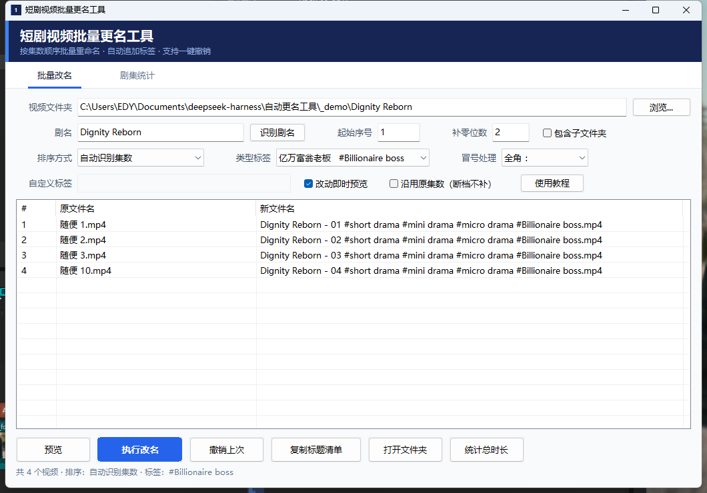
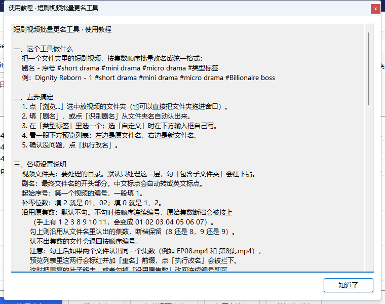
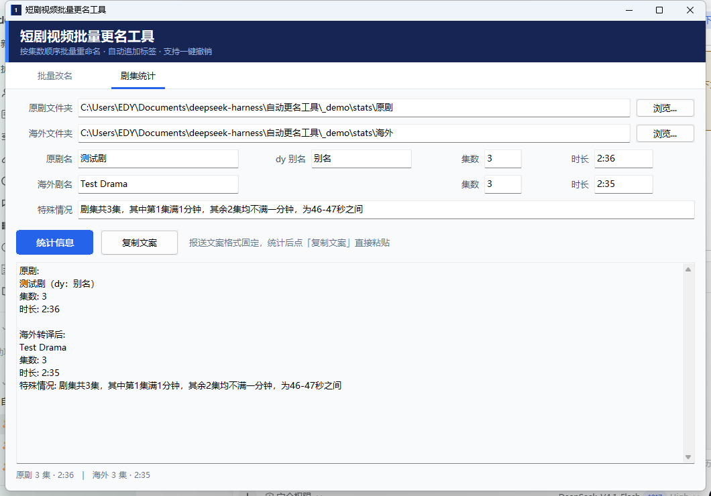
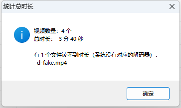

# 短剧视频批量更名工具（C++ 桌面版）

一个原生 Windows 小软件，把短剧视频按集数顺序批量改成发布用的标准标题。

> **下载**：[Releases 里的 `short-drama-renamer.exe`](https://github.com/crazyzhang277/short-drama-renamer/releases/latest)
> —— 单文件、免安装、无需运行库，双击即用。





---

## 一、直接使用

双击 **`短剧更名工具.exe`** 即可。单文件、免安装、无需任何运行库（已静态链接）。

使用流程只有四步：

1. **选择文件夹** —— 点「浏览...」选视频所在目录，或直接把文件夹拖进窗口
2. **填剧名** —— 例如 `Dignity Reborn`；也可以点「识别剧名」从文件夹名自动认出来
3. **选类型标签** —— 下拉框里挑一个，或在「自定义标签」里自己写
4. **检查预览列表 → 点「执行改名」**

改名是**原地**进行的，不会移动或复制文件。

界面上还有这些便利开关：

- **识别剧名**：从当前文件夹路径里认剧名，盘符（`C:` `D:`）、`Users`、`Desktop`、
  `下载`、`视频`、`短剧`、`新建文件夹` 这类通用目录名会被跳过。认不出来就弹提示，不会乱填。
- **改动即时预览**（默认开启）：改任何设置（换标签、改序号、换排序、改冒号处理……）
  都会自动刷新下方预览列表，不用反复点「预览」。
- **使用教程**：软件内自带一份图文说明，随时点开看。
- **统计总时长**：按当前选中的文件夹（和「包含子文件夹」开关）把所有视频的时长加起来，
  弹窗给出视频数量、总时长，以及读不到时长的文件清单。详见第六节。
- **剧集统计页签**：顶部切到「剧集统计」，填原剧、海外两个文件夹，自动算集数、总时长、特殊情况，
  并生成可直接粘贴的报送文案。详见第五节。

---

## 二、命名规则

```
剧名 - 序号 #short drama #mini drama #micro drama #类型标签.扩展名
```

示例：

```
Dignity Reborn - 01 #short drama #mini drama #micro drama #Billionaire boss.mp4
```

- **剧名**：手填，或点「识别剧名」从文件夹名自动填入。里面的中文标点会自动转成英文标点
  （`，`→`,`、`：`→`:`、`‘’`→`'`、`“”`→`"`、`！`→`!`、`？`→`?`、`（）`→`()`）
- **序号**：从「起始序号」开始递增；「补零位数」控制是否补零（2 = `01`、`02` …，0 = `1`、`2` …）
  集数有断档时，默认会**自动接上**；不想接上就勾「沿用原集数」，详见下面一节
- **固定标签**：`#short drama #mini drama #micro drama` 三个始终带上
- **类型标签**：下拉框选择，只出一个

### 类型标签对照表

| 中文 | 英文标签 |
| --- | --- |
| 亿万富翁老板 | `#Billionaire boss` |
| 首席执行官恋情 | `#CEO romance` |
| 真正的继承人 | `#True heiress` |
| 隐藏的身份 | `#Hidden identity` |
| 契约婚姻 | `#forced marriage` |
| 阿尔法 | `#Alpha` |
| 马特 | `#Mate` |
| 狼人 | `#Werewolf` |
| 离婚复仇 | `#Divorce revenge` |
| 秘密宝贝 | `#Secret baby` |
| 单身妈妈 | `#Single mom` |
| 继兄浪漫 | `#Stepbrother romance` |
| 禁忌之爱 | `#Forbidden love` |
| 黑手党浪漫 | `#Mafia romance` |
| 黑暗浪漫 | `#Dark romance` |

### 关于冒号

Windows 文件名不允许半角 `:`，所以剧名里如果有冒号，默认换成**全角 `：`**。
下拉框「冒号处理」可以改成 ` - ` 或空格。

同时软件会在 `.rename-tool\titles.txt` 里存一份**带标准英文冒号**的完整标题清单，
复制到发布后台时用那一份即可（点「复制标题清单」按钮）。

### 序号怎么算（集数断档怎么办）

手上有 `1 2 3 8 9 10 11` 这种中间断开的文件时，两种做法都支持：

| 模式 | 界面设置 | 结果 |
| --- | --- | --- |
| **连续编号**（默认） | 不勾「沿用原集数」 | `01 02 03 04 05 06 07` —— 断档被自动接上，原来的 8 变成 4 |
| **沿用原集数** | 勾上「沿用原集数」 | `01 02 03 08 09 10 11` —— 断档保留，8 还是 8 |

细节：

- **连续编号**按排序后的**位置**发号，与文件名里的数字无关。起始序号填 1 就从 01 开始，填 5 就从 05 开始。
- **沿用原集数**用的是从文件名里识别出的集数。识别不出集数的文件（比如 `花絮.mp4`）
  会退回按位置编号，不会被漏掉。
- 沿用原集数时如果两个文件识别出同一个集数（例如 `EP08.mp4` 和 `第8集.mp4`），
  **预览列表里这两行会标红并加上「⚠ 重名」前缀**，状态栏也会提示有几个重名；
  点「执行改名」会被「新名重复」检查拦下，列出冲突清单，不会真的改成重名。
  处理办法：把重复的片子移走，或者勾掉「沿用原集数」改回连续编号。

### 识别剧名是怎么判断的

点「识别剧名」时，软件从文件夹路径**最里层往外**找第一个像剧名的目录名，跳过这些：

- 盘符：`C:` `D:` `E:` …
- 系统/用户目录：`Users`、`Desktop`、`Documents`、`Downloads`、`Videos`、`AppData`、`Program Files` …
- 中文通用目录：`视频`、`短剧`、`影视`、`素材`、`下载`、`桌面`、`新建文件夹`、`待处理` …
- 纯数字、纯符号、没有字母的名字

英文名会自动首字母大写，下划线 / 连字符 / 点会换成空格（`the_lost-HEIRESS.of time` → `The Lost Heiress Of Time`），
`CEO`、`TV` 这类短全大写词保持原样。中文名原样保留。

找不到时不会乱填，会弹提示让你手动输入。

---

## 三、排序是怎么判断的

「排序方式」下拉框三选一：

| 选项 | 行为 |
| --- | --- |
| **自动识别集数**（默认） | 从文件名里抠集数；能认出 60% 以上就按集数排，否则退回文件名自然排序 |
| **文件名自然排序** | 按文件名里的数字大小排（`EP9` 在 `EP10` 前面） |
| **修改时间** | 按文件修改时间排 |

集数识别的优先级（数字越大越优先）：

| 写法 | 优先级 |
| --- | --- |
| `第12集` | 130 |
| `X集` | 125 |
| `S01E07` | 120 |
| `EP05` / `E05` | 110 |
| `[08]` / `(08)` | 80 |
| 结尾数字 `剧名 13` | 60 |
| 开头数字 `09.mp4` | 50 |

会自动排除这些干扰数字：`240 264 265 360 480 576 720 1080 1280 1440 1920 2160 4320`，
以及 `1900–2099` 的年份。

---

## 四、安全机制

- **预览先行**：点「执行改名」前必须先预览，看到完整新旧对照表才会动手
- **直接改名**：冲突检查通过后，原地将文件改为目标名，不经过临时隐藏文件名
- **冲突拦截**：目标重名、目标已存在、路径超长、非法字符，全部在动手前拦下并列出清单
- **失败回滚**：中途出错会自动把已经改过的文件还原，并说明原因（被占用 / 没权限 / 路径太长 / 目标已存在）
- **一键撤销**：每次改名都会写 `.rename-tool\undo-<时间戳>.txt`，点「撤销上次」即可完整还原，还原后自动删掉该记录

`.rename-tool` 是软件在视频目录里自动建的隐藏工作目录，里面只有撤销记录和标题清单，不碰视频。

---

## 五、剧集统计（报送文案）

顶部页签切到「剧集统计」，把微信报送要的信息一次算好：



- **原剧文件夹 / 海外文件夹**：各选一个目录（都吃「包含子文件夹」），点「统计信息」两边一起扫
- **剧名**：选完文件夹自动按目录名认出来，认错了直接改
- **集数 / 时长**：自动统计，总时长按各集四舍五入后的秒数相加，显示成 `分:秒`，超过一小时是 `时:分:秒`
- **特殊情况**：按海外剧每集的时长自动判断——哪几集满 1 分钟、其余几集不满 1 分钟、区间多少秒，
  写法和微信模板一致
- **报送文案框**：格式固定（`原剧:` / `集数:` / `时长:` / `海外转译后:` / `特殊情况:`），
  改上面任何一格都会立刻同步；点「复制文案」直接粘给对方

两个文件夹填成同一个也行，只扫一次。集数、时长可以手改，重新统计会覆盖。

---

## 六、支持的文件类型

```
mp4 mkv mov avi wmv flv m4v ts webm mpg mpeg rmvb rm 3gp m2ts vob ogv divx asf f4v
```

其它文件（`.txt`、`.jpg` 等）会被忽略，不会参与改名。

勾选「包含子文件夹」会递归扫描所有子目录。

### 统计总时长

点「统计总时长」，弹窗会告诉你这个文件夹一共多少个视频、加起来多长：



时长用 Windows 自带的 Media Foundation 读（mp4 / mkv / avi / mov / ts / webm / wmv 都没问题）。
`flv`、`rmvb` 这类系统没有解码器的格式读不到时长，不会算错，只会在弹窗里单独列出来，
统计结果不受影响。

---

## 七、设置记忆

窗口里的路径、剧名、序号、补零、标签等，关掉后会自动存进同目录的 `settings.ini`，下次打开自动带出来。

---

## 八、从源码重新编译

编译环境是 MinGW-w64 GCC 15.2.0（便携解压版，装在 `C:\Users\EDY\AppData\Local\dsh-tools\msys2`）。

```powershell
# 如果换了机器 / 环境丢了，先装工具链（约 19 个包，走清华镜像）
pwsh -NoProfile -File .\install-toolchain.ps1

# 编译
build.bat
```

产物：`短剧更名工具.exe`

源码结构：

```
src/main.cpp        全部逻辑与界面（约 2600 行，纯 Win32 + GDI + Media Foundation，无第三方库）
src/app.rc          资源脚本
src/app.manifest    Common-Controls v6 + DPI 感知 + 系统版本声明
src/app.ico         图标
```

编译参数：`-std=c++17 -O2 -municode -mwindows -static -static-libgcc -static-libstdc++`

---

## 九、自检

软件内置 59 项自检（集数识别、自然排序、标点转换、端到端改名、撤销、子目录过滤、剧名识别、断档编号、时长格式化、失败原因提示、剧集统计与报送文案）：

```powershell
.\短剧更名工具.exe --selftest
```

结果写入同目录 `selftest.log`，退出码 0 表示全通过。

---

## 十、目录说明

```
短剧更名工具.exe      主程序（双击运行）
build.bat             编译脚本
install-toolchain.ps1 安装 C++ 编译环境
README.md             本文档
shot.png              界面截图
shot-stats.png        剧集统计页截图
shot-tutorial.png     使用教程窗口截图
shot-duration-dialog.png  统计总时长弹窗截图
selftest.log          最近一次自检结果
src\                  源码
tools\                开发期用的自动化测试脚本（截图 / 布局检查 / 端到端测试）
legacy-node\          最早的 Node.js 命令行版本（已被本版本取代，留作参考）
```
